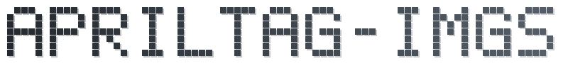

<div align="center">

<picture>
  <source media="(prefers-color-scheme: dark)" srcset=".github/assets/banner-dark.svg">
  <source media="(prefers-color-scheme: light)" srcset=".github/assets/banner-light.svg">
  
</picture>

<h1>🏷️ AprilTag-imgs (fork)</h1>

<p><b>Pre-generated images of every AprilTag 3 tag family, ready for AI coding agents</b></p>

<p>
  <a href="LICENSE"></a>
  <a href="https://github.com/AprilRobotics/apriltag-imgs"></a>
  <a href="https://github.com/rohanhong/apriltag-imgs/commits/master"></a>
  <a href="https://github.com/rohanhong/apriltag-imgs/stargazers"></a>
  <a href="https://agents.md"></a>
  <a href="https://agentskills.io"></a>
</p>

<p>🌐 <b>English</b> | <a href="docs/i18n/README.zh-CN.md">简体中文</a></p>

</div>

> [!IMPORTANT]
> This is an unofficial fork of
> [AprilRobotics/apriltag-imgs](https://github.com/AprilRobotics/apriltag-imgs).
> It is not affiliated with or endorsed by the University of Michigan, the
> APRIL Robotics Laboratory, or the upstream maintainers. The tag images and
> `tag_to_svg.py` are unchanged from upstream.

Images of all tags from all the pre-generated
[AprilTag 3](https://github.com/AprilRobotics/apriltag) families. You can
generate your own layouts or images of tags with
[AprilTag-generation](https://github.com/AprilRobotics/apriltag-generation).
This fork adds one tool-neutral set of agent instructions (`AGENTS.md`) and
skills (`.agents/skills`), so any AI coding agent can work in the repository
with the same rules.

## ✨ Highlights

- 🖼️ **Every pre-generated family**: eight families, about 159,000 tag PNGs,
  plus a mosaic and a PostScript sheet for each family.
- 📐 **Print at any size**: `tag_to_svg.py` turns a tag into an SVG with a
  physical size.
- 🤖 **Agent-ready**: `AGENTS.md` and 15 skills for git, docs, and setup
  work, with Claude Code adapters included.
- 🛡️ **Upstream intact**: images, script, and BSD-2-Clause license are
  unchanged, and the fork syncs from upstream by a plain merge.

## 📦 Tag Families

| Directory | Tags | Tag image (px) |
|---|---|---|
| `tag16h5` | 30 | 8 x 8 |
| `tag25h9` | 35 | 9 x 9 |
| `tag36h11` | 587 | 10 x 10 |
| `tagCircle21h7` | 38 | 9 x 9 |
| `tagCircle49h12` | 65,698 | 11 x 11 |
| `tagCustom48h12` | 42,211 | 10 x 10 |
| `tagStandard41h12` | 2,115 | 9 x 9 |
| `tagStandard52h13` | 48,714 | 10 x 10 |

Each tag is one file named `tag<bits>_<hamming>_<id>.png`, for example
`tag36h11/tag36_11_00000.png`. Each directory also holds `mosaic.png` and
`alltags.ps`.

## 🚀 Quick Start

> [!NOTE]
> Rescaling needs [ImageMagick](https://imagemagick.org). The SVG script needs
> Python 3 with Pillow (`pip install Pillow`).

1. Clone the repository:
   ```bash
   git clone https://github.com/rohanhong/apriltag-imgs.git
   ```
2. The tag images are very small (8 to 11 pixels wide), so rescale one
   before use (Unix; on ImageMagick 7, `magick` replaces `convert`):
   ```bash
   convert <small_marker>.png -scale <scale_chosen_in_percent>% <big_marker>.png
   ```
3. Or create an SVG (Scalable Vector Graphics) version of a tag:
   ```bash
   python3 tag_to_svg.py tagStandard52h13/tag52_13_00007.png tag52_13_00007.svg --size=20mm
   ```

<details>
<summary>Clone only one tag family</summary>

```bash
git clone --filter=blob:none --sparse https://github.com/rohanhong/apriltag-imgs.git
cd apriltag-imgs
git sparse-checkout set tag36h11
```

</details>

## 🤖 AI Agent Support

| Path | Purpose |
|---|---|
| `AGENTS.md` | Agent instructions: project facts, commands, conventions, and the fork rules |
| `.agents/skills/` | The skills below, in the open Agent Skills format |
| `CLAUDE.md`, `.claude/skills` | Claude Code adapters: an `@AGENTS.md` import and a link to `.agents/skills` |
| `.gitmessage` | Commit format and workflow (`trunk-solo`, branch naming Variant C) |
| `.gitattributes`, `.gitignore` | Line endings, binary markers, and ignore rules |
| `.github/settings.yml` | Record of the GitHub About panel; GitHub does not read it, so apply changes by hand |

| Group | Skills | What they do |
|---|---|---|
| 🌿 Git | `git-branch-create` `git-commit` `git-fetch` `git-pull` `git-merge` `git-push` `git-tag` `git-branch-delete` | Branch, commit, sync, merge, publish, and tag per `.gitmessage` |
| 🏗️ Setup | `repo-init` `repo-docs` `py-env-setup` | Check the git setup, keep the README current, create a conda env |
| 🤗 HF Hub | `hf-setup` `hf-upload` `hf-download` | Host large artifacts with pinned, verified revisions |

The skills stop for your confirmation before anything that is hard to undo.
They need git 2.22 or later and a POSIX shell (Git Bash on Windows).

> [!IMPORTANT]
> On Windows, `.claude/skills` is a symbolic link. Enable Developer Mode and
> run `git config --global core.symlinks true` before cloning; otherwise
> Claude Code finds no skills. `AGENTS.md` (Layout) has the repair steps.

## 🔄 Syncing with Upstream

The `upstream` remote points at the original repository:

```bash
git remote add upstream https://github.com/AprilRobotics/apriltag-imgs.git   # once
git fetch upstream
git merge upstream/master   # or run the git-merge skill with source upstream/master
```

Upstream is in maintenance mode and accepts no pull requests that add new
functionality. The agent tooling comes from the maintainer's own repository
template; to update it, replace `.agents/skills/` with the template's newer
copy and review the diff.

## 📚 Documentation

| Topic | Where |
|---|---|
| Agent instructions, fork rules, layout, skill authoring | [`AGENTS.md`](AGENTS.md) |
| Commit format, workflow variants, branch naming, tags | [`.gitmessage`](.gitmessage) |
| Each skill's procedure and rules | [`.agents/skills/<name>/SKILL.md`](.agents/skills) |
| SVG converter options | `python3 tag_to_svg.py --help` |

## 🤝 Contributing

Changes to the tag images or `tag_to_svg.py` belong upstream. Issues and pull
requests about this fork's additions are welcome here; commit messages follow
[`.gitmessage`](.gitmessage).

## 🔗 Resources

- [AprilRobotics/apriltag-imgs](https://github.com/AprilRobotics/apriltag-imgs): the upstream repository.
- [AprilTag](https://github.com/AprilRobotics/apriltag): the detection library.
- [AprilTag-generation](https://github.com/AprilRobotics/apriltag-generation): generate custom layouts and tag images.
- [AprilTag project page](https://april.eecs.umich.edu/software/apriltag): background and papers.
- [AGENTS.md](https://agents.md) and [Agent Skills](https://agentskills.io): the open formats for agent instructions and skills.

## ⚖️ Legal

- **License**: [BSD 2-Clause](LICENSE), Copyright (c) 2013-2016, The Regents
  of The University of Michigan. The fork's additions (agent instructions,
  skills, and docs) are offered under the same terms.
- **Affiliation**: an unofficial fork. Upstream names appear only to identify
  the original project and imply no endorsement.

## ⭐ Star History

<a href="https://www.star-history.com/#rohanhong/apriltag-imgs&Date">
  <picture>
    <source media="(prefers-color-scheme: dark)" srcset="https://api.star-history.com/svg?repos=rohanhong/apriltag-imgs&type=Date&theme=dark">
    <source media="(prefers-color-scheme: light)" srcset="https://api.star-history.com/svg?repos=rohanhong/apriltag-imgs&type=Date">
    
  </picture>
</a>
